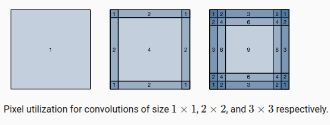
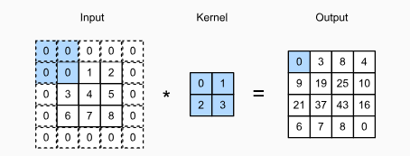
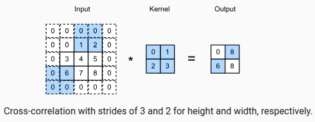

<!-- ::: watermark -->

<!--  -->

<!-- ::: -->

# Redes Neuronales Convolucionales

Las redes neuronales convolucionales, o **CNN** por sus siglas en inglés, fueron diseñadas para aprovechar la estructura espacial de las imágenes. A diferencia de una red completamente conectada, una CNN no trata a cada pixel como una variable aislada e independiente, sino como parte de un vecindario con relaciones locales muy importantes.

Esta idea trae dos ventajas centrales. Primero, reduce drásticamente el número de parámetros del modelo. Segundo, incorpora un sesgo inductivo muy útil: si un patrón visual aparece en una parte de la imagen, queremos poder reconocerlo también cuando aparece en otra.

En esta sección construiremos la intuición detrás de las convoluciones y después veremos cómo se aplican directamente sobre imágenes bidimensionales.

Fuente de referencia y adaptación original en español:

-   [Dive into Deep Learning, Capítulo 7](https://d2l.ai/chapter_convolutional-neural-networks/index.html)
-   [Sección 7.1: From Fully Connected Layers to Convolutions](https://d2l.ai/chapter_convolutional-neural-networks/why-conv.html)
-   [Sección 7.2: Convolutions for Images](https://d2l.ai/chapter_convolutional-neural-networks/conv-layer.html)

**De capas densas a convoluciones**

Si quisiéramos procesar una imagen con una red densa tradicional, podríamos aplanarla en un vector y conectar cada pixel con cada neurona oculta. El problema es que esta estrategia ignora la estructura espacial de la imagen y además introduce una cantidad enorme de parámetros.

Por ejemplo, una imagen de tamaño moderado puede contener cientos de miles de pixeles. Si cada unidad oculta dependiera de todos ellos, el costo en memoria y cómputo crecería demasiado rápido. Más importante todavía, perderíamos conocimiento útil sobre el dominio: en imágenes, los pixeles cercanos suelen estar más relacionados entre sí que los pixeles lejanos.

Las CNN resuelven esto imponiendo dos principios:

1.  **Invariancia o equivarianza por traslación**. Un patrón relevante debe poder detectarse sin importar en qué parte de la imagen aparece.
2.  **Localidad**. Para describir lo que ocurre en una posición, normalmente basta con mirar una región cercana.

Estas dos ideas nos llevan de forma natural a la operación de convolución.

## De capas completamente conectadas a convoluciones

### Invariancia

Imagina que queremos detectar un objeto en una imagen, por ejemplo un balón, un rostro o una señal de tránsito. Sería poco razonable que el sistema solo pudiera reconocerlo cuando aparece exactamente en una coordenada específica. Si el objeto se desplaza un poco hacia la derecha o hacia arriba, la respuesta del modelo debería seguir siendo coherente.

Ese comportamiento deseado se conoce como **invariancia por traslación** o, de manera más precisa en capas intermedias, **equivarianza por traslación**. En términos intuitivos, si el patrón se mueve en la imagen, su activación también se mueve de forma consistente en el mapa de características.


Una manera útil de pensar en esto es el juego de "¿Dónde está Wally?". Aunque el personaje cambie de posición dentro de la escena, seguimos buscando el mismo patrón visual: colores, forma, accesorios y contexto local.

### Restringiendo un perceptrón multicapa

Supongamos que la entrada es una imagen bidimensional `X` y que la representación oculta es otra matriz `H` del mismo tamaño. Si usáramos una capa completamente conectada, cada posición `(i,j)` de `H` dependería de todas las posiciones `(k,l)` de `X`:

$$
[\mathbf{H}]_{i,j} = [\mathbf{U}]_{i,j} + \sum_k \sum_l [\mathsf{W}]_{i,j,k,l} [\mathbf{X}]_{k,l}
$$

Esta formulación es muy flexible, pero también muy costosa. Para convertirla en algo útil para visión por computadora, introducimos restricciones estructurales.

#### Invariancia por traslación

Si queremos tratar del mismo modo al mismo patrón sin importar dónde aparece, los pesos no deberían depender explícitamente de la posición absoluta `(i,j)`. Podemos reescribir la transformación usando desplazamientos relativos:

$$
[\mathbf{H}]_{i,j} = u + \sum_a \sum_b [\mathbf{V}]_{a,b} [\mathbf{X}]_{i+a,j+b}
$$

Ahora el mismo conjunto de pesos `V` se reutiliza en todas las ubicaciones. Esto se conoce como **compartición de parámetros** y es una de las ideas más poderosas de las CNN.

#### Localidad

El segundo supuesto es que no necesitamos observar toda la imagen para decidir qué ocurre en una posición local. Basta con mirar una ventana cercana. Entonces imponemos que los pesos sean cero fuera de una vecindad acotada:

$$
[\mathbf{H}]_{i,j} = u + \sum_{a=-\Delta}^{\Delta}\sum_{b=-\Delta}^{\Delta} [\mathbf{V}]_{a,b} [\mathbf{X}]_{i+a,j+b}
$$

Con esta restricción, el número de parámetros baja de manera drástica. En vez de aprender una matriz gigante de conexiones, solo aprendemos un filtro pequeño que se desliza por toda la imagen.

En esencia, esta ecuación ya describe una **capa convolucional**.

### Convoluciones

En matemáticas, la convolución entre dos funciones puede definirse como:

$$
(f * g)(\mathbf{x}) = \int f(\mathbf{z}) g(\mathbf{x} - \mathbf{z}) d\mathbf{z}
$$

En el caso discreto unidimensional:

$$
(f * g)(i) = \sum_a f(a) g(i-a)
$$

Y en dos dimensiones:

$$
(f * g)(i,j) = \sum_a \sum_b f(a,b) g(i-a,j-b)
$$

En aprendizaje profundo, la operación que implementamos casi siempre es en realidad una **correlación cruzada**, porque no se invierte el kernel. Sin embargo, en la práctica todo el mundo la llama "convolución" y seguiremos esa convención.

### Canales

Hasta aquí pensamos en una sola matriz de entrada, pero las imágenes reales suelen tener varios canales. Una imagen RGB, por ejemplo, tiene tres: rojo, verde y azul. Del mismo modo, una capa convolucional puede producir múltiples canales de salida, cada uno especializado en detectar cierto tipo de patrón.

En ese caso, la operación general toma la forma:

$$
[\mathsf{H}]_{i,j,d} = \sum_{a=-\Delta}^{\Delta}\sum_{b=-\Delta}^{\Delta}\sum_c [\mathsf{V}]_{a,b,c,d} [\mathsf{X}]_{i+a,j+b,c}
$$

donde:

-   `c` indexa los canales de entrada
-   `d` indexa los canales de salida
-   `V` es el conjunto de filtros aprendibles


Cada filtro responde con mayor intensidad allí donde detecta un patrón particular. En capas profundas, esos patrones dejan de ser simples bordes o texturas y pueden representar partes de objetos o configuraciones visuales más complejas.

### Resumen

-   Las CNN explotan la estructura espacial de las imágenes.
-   La compartición de parámetros permite detectar el mismo patrón en distintas posiciones.
-   La localidad reduce el costo computacional y favorece el aprendizaje de patrones visuales cercanos.
-   Una capa convolucional opera con filtros pequeños que se aplican a toda la entrada.
-   Los canales permiten aprender múltiples detectores de características al mismo tiempo.

## Convoluciones para imágenes

Ahora que ya tenemos la motivación, pasemos a la operación concreta sobre imágenes.

### Operación de correlación cruzada

La operación básica toma una entrada bidimensional `X` y un kernel `K`, también llamado filtro. El kernel se desliza por la imagen y, en cada posición, calcula un producto punto entre sus valores y la región correspondiente de la entrada.


Si usamos:

$$
\mathbf{X} =
\begin{bmatrix}
0 & 1 & 2 \\
3 & 4 & 5 \\
6 & 7 & 8
\end{bmatrix},
\quad
\mathbf{K} =
\begin{bmatrix}
0 & 1 \\
2 & 3
\end{bmatrix}
$$

entonces la salida se obtiene evaluando:

$$
\begin{aligned}
0\times0 + 1\times1 + 3\times2 + 4\times3 &= 19\\
1\times0 + 2\times1 + 4\times2 + 5\times3 &= 25\\
3\times0 + 4\times1 + 6\times2 + 7\times3 &= 37\\
4\times0 + 5\times1 + 7\times2 + 8\times3 &= 43
\end{aligned}
$$

Por tanto:

$$
\mathbf{Y} =
\begin{bmatrix}
19 & 25 \\
37 & 43
\end{bmatrix}
$$

Si la entrada tiene tamaño `n_h x n_w` y el kernel tiene tamaño `k_h x k_w`, entonces la salida tendrá tamaño:

$$
(n_h-k_h+1) \times (n_w-k_w+1)
$$

### Implementación manual en Python

Una implementación sencilla de correlación cruzada en dos dimensiones puede escribirse así:

``` python
import torch

def corr2d(X, K):
    h, w = K.shape
    Y = torch.zeros((X.shape[0] - h + 1, X.shape[1] - w + 1))
    for i in range(Y.shape[0]):
        for j in range(Y.shape[1]):
            Y[i, j] = (X[i:i + h, j:j + w] * K).sum()
    return Y

X = torch.tensor([[0.0, 1.0, 2.0],
                  [3.0, 4.0, 5.0],
                  [6.0, 7.0, 8.0]])

K = torch.tensor([[0.0, 1.0],
                  [2.0, 3.0]])

print(corr2d(X, K))
```

Salida esperada:

``` python
tensor([[19., 25.],
        [37., 43.]])
```

Este ejemplo es útil porque deja ver con claridad lo que hace la operación, aunque en la práctica las bibliotecas profundas usan implementaciones mucho más optimizadas.

### Una capa convolucional simple

Una capa convolucional aprende automáticamente los valores del kernel y del sesgo. Conceptualmente, podríamos modelarla así:

``` python
import torch
from torch import nn

class Conv2D(nn.Module):
    def __init__(self, kernel_size):
        super().__init__()
        self.weight = nn.Parameter(torch.rand(kernel_size))
        self.bias = nn.Parameter(torch.zeros(1))

    def forward(self, x):
        return corr2d(x, self.weight) + self.bias
```

En un entrenamiento real, esos parámetros se ajustan mediante descenso de gradiente para que el filtro detecte los patrones más útiles para la tarea.

### Detección de bordes en imágenes

Una de las aplicaciones más intuitivas de un kernel es detectar bordes. Por ejemplo, si queremos identificar transiciones verticales, podemos usar un filtro como:

$$
\mathbf{K} =
\begin{bmatrix}
1 & -1
\end{bmatrix}
$$

Este kernel responde fuertemente cuando encuentra un cambio brusco entre una columna y la siguiente.

``` python
import torch

X = torch.ones((6, 8))
X[:, 2:6] = 0
K = torch.tensor([[1.0, -1.0]])

Y = corr2d(X, K)
print(Y)
```

Aquí la imagen sintética contiene una franja vertical oscura en medio de una región clara. La salida tendrá activaciones marcadas justamente en las fronteras entre ambas regiones.

### Aprendiendo un kernel

No siempre especificamos manualmente el filtro. También podemos dejar que la red lo aprenda. Si tomamos una entrada `X` y una salida deseada `Y`, podemos optimizar una capa convolucional para que descubra automáticamente un kernel que transforme `X` en `Y`.

``` python
import torch
from torch import nn

X = X.reshape((1, 1, 6, 8))
Y = Y.reshape((1, 1, 6, 7))

conv2d = nn.Conv2d(1, 1, kernel_size=(1, 2), bias=False)
lr = 3e-2

for i in range(10):
    Y_hat = conv2d(X)
    loss = (Y_hat - Y) ** 2
    conv2d.zero_grad()
    loss.sum().backward()
    conv2d.weight.data[:] -= lr * conv2d.weight.grad
    if (i + 1) % 2 == 0:
        print(f"epoch {i+1}, loss {loss.sum():.3f}")

print(conv2d.weight.data.reshape((1, 2)))
```

Después de varias iteraciones, el kernel aprendido se acerca a `[[1, -1]]` o a una versión equivalente, mostrando que la capa puede descubrir por sí sola un detector de bordes.

### Correlación cruzada y convolución

Conviene insistir en la diferencia terminológica:

-   En **correlación cruzada**, el kernel se usa tal cual.
-   En **convolución estricta**, el kernel se invierte horizontal y verticalmente antes de aplicarse.

En deep learning casi todas las implementaciones usan correlación cruzada, pero la comunidad mantiene el nombre de "convolución" por costumbre.

### Mapa de características y campo receptivo

La salida de una capa convolucional suele llamarse **mapa de características**. Cada una de sus posiciones resume la respuesta del filtro en una región concreta de la entrada.

El **campo receptivo** de una neurona es la región de la entrada original que puede influir en su valor. En una primera capa, ese campo coincide con el tamaño del kernel. En redes profundas, el campo receptivo crece conforme apilamos más capas.

Esto es muy importante porque permite combinar evidencia local en patrones cada vez más globales:

-   las primeras capas detectan bordes y texturas
-   las capas intermedias reconocen partes
-   las capas profundas integran configuraciones más complejas

### Resumen

-   La operación fundamental de una capa convolucional es la correlación cruzada.
-   El kernel se desliza sobre la entrada y produce una salida más pequeña si no usamos relleno.
-   Los filtros pueden diseñarse manualmente, por ejemplo para detectar bordes.
-   En aprendizaje profundo, normalmente los filtros se aprenden a partir de los datos.
-   Los mapas de características y el campo receptivo ayudan a interpretar cómo procesa información una CNN.

### Ideas clave del capítulo

Las redes convolucionales surgen al imponer una estructura adecuada para datos con organización espacial. En lugar de aprender conexiones arbitrarias entre todos los pixeles, aprenden filtros locales que se reutilizan a lo largo de toda la imagen. Esa combinación de localidad, compartición de parámetros y profundidad explica buena parte de su éxito en visión por computadora.

En las siguientes secciones veremos cómo ajustar el tamaño efectivo de la salida mediante *padding* y *stride*, cómo trabajar con múltiples canales y cómo construir arquitecturas convolucionales más completas.

## Padding and Stride

Hasta ahora, las convoluciones se han aplicado desplazando el kernel sobre toda la imagen sin modificar el tamaño del kernel ni la forma en que este se mueve. Sin embargo, en redes convolucionales reales surge un problema importante: **cada convolución suele reducir el tamaño espacial de la representación**.

Supongamos una entrada de tamaño $n_h \times n_w$ y un kernel de tamaño $k_h \times k_w$. Si no utilizamos padding ni stride especial, la salida tendrá dimensiones:

$$
(n_h-k_h+1)\times(n_w-k_w+1)
$$

Esto ocurre porque el kernel solo puede desplazarse mientras permanezca completamente dentro de la imagen.

### ¿Por qué esto es un problema? {.unnumbered}

Cada convolución elimina información de los bordes. Aunque la pérdida parezca pequeña en una sola capa, puede acumularse rápidamente.

Por ejemplo:

-   Imagen original: $240 \times 240$
-   Diez capas convolucionales consecutivas con kernels $5 \times 5$

Cada convolución reduce la dimensión en 4 píxeles por lado:

$$
240 \rightarrow 236 \rightarrow 232 \rightarrow \cdots \rightarrow 200
$$

Después de diez capas, la imagen se reduce a:

$$
200 \times 200
$$

Es decir, se pierde aproximadamente el **30% del área original**, incluyendo información potencialmente importante cerca de los bordes.

Para controlar el tamaño de las salidas se utilizan principalmente dos técnicas:

1.  **Padding**: agrega píxeles artificiales alrededor de la imagen para evitar la pérdida de información en los bordes.
2.  **Stride**: controla cuánto se desplaza el kernel en cada paso, permitiendo reducir deliberadamente la resolución de la representación.

En esta sección nos enfocaremos primero en **padding**.

## Padding

### Motivación {.unnumbered}

En una convolución estándar, los píxeles cercanos a los bordes participan en menos operaciones que los píxeles centrales.

Los píxeles de las esquinas son especialmente problemáticos, ya que aparecen en muy pocas ventanas de convolución. Como consecuencia, la red aprovecha menos la información contenida en esas regiones.

```{r echo=FALSE, fig.align='center', out.height='250pt', out.width='600pt'}

```

Aunque cada convolución elimine únicamente unos cuantos píxeles, el efecto acumulado de muchas capas puede ser considerable.

### Idea principal {.unnumbered}

La solución más simple consiste en **agregar píxeles adicionales alrededor de la imagen antes de realizar la convolución**.

Estos píxeles suelen rellenarse con ceros, por lo que esta técnica recibe el nombre de **zero-padding**.

Por ejemplo, una imagen de:

$$
3\times3
$$

puede expandirse a:

$$
5\times5
$$

agregando una fila y una columna de ceros en cada lado.

```{r echo=FALSE, fig.align='center', out.height='250pt', out.width='600pt'}

```


Ahora el kernel puede centrarse también sobre los píxeles cercanos al borde sin perder información.

### Tamaño de salida con padding {.unnumbered}

Si agregamos:

-   $p_h$ filas de padding en total
-   $p_w$ columnas de padding en total

entonces el tamaño de salida se convierte en:

$$
\lfloor(n_h-k_h+p_h+1)\rfloor\times\lfloor(n_w-k_w+p_w+1)\rfloor
$$

Observamos que el padding incrementa directamente el tamaño de la salida.

### Preservar dimensiones {.unnumbered}

En muchas arquitecturas deseamos que la entrada y la salida tengan exactamente el mismo tamaño.

Para lograrlo:

$$
p_h = k_h-1
$$

$$
p_w = k_w-1
$$

Sustituyendo en la ecuación anterior:

$$
(n_h-k_h+(k_h-1)+1)=n_h
$$

$$
(n_w-k_w+(k_w-1)+1)=n_w
$$

Por lo tanto:

$$
\text{altura salida} = \text{altura entrada}
$$

$$
\text{anchura salida} = \text{anchura entrada}
$$

Esto simplifica enormemente el diseño de la red porque cada capa mantiene las mismas dimensiones espaciales.

### ¿Por qué suelen usarse kernels impares? {.unnumbered}

La mayoría de las CNN utilizan kernels:

$$
1\times1,\quad 3\times3,\quad 5\times5,\quad 7\times7
$$

es decir, tamaños impares.

La razón principal es que existe un píxel central claramente definido.

Por ejemplo, en un kernel:

$$
3\times3
$$

el elemento central está en:

$$
(2,2)
$$

Esto permite colocar la ventana de convolución perfectamente centrada sobre cada píxel de la imagen.

Además, el padding puede distribuirse de forma simétrica:

-   una fila arriba y una abajo
-   una columna a la izquierda y una a la derecha

Ejemplo:

Kernel:

$$
3\times3
$$

Padding necesario:

$$
p=2
$$

Distribución:

-   1 fila arriba
-   1 fila abajo
-   1 columna izquierda
-   1 columna derecha

La entrada y salida mantienen exactamente las mismas dimensiones.

### Interpretación intuitiva {.unnumbered}

Cuando utilizamos:

-   kernel impar
-   padding simétrico

cada valor de salida $Y[i,j]$ puede interpretarse como el resultado de aplicar el kernel sobre una ventana centrada en el píxel correspondiente $X[i,j]$.

Esto facilita enormemente la interpretación geométrica de la convolución.

En cierto sentido, cada píxel de salida representa una combinación ponderada de la vecindad alrededor del píxel correspondiente en la entrada.

### Ejemplo en PyTorch

A continuación definimos una función auxiliar para aplicar convoluciones bidimensionales y visualizar fácilmente sus dimensiones de salida.

```{python}
import torch
from torch import nn

# We define a helper function to calculate convolutions. It initializes the
# convolutional layer weights and performs corresponding dimensionality
# elevations and reductions on the input and output
def comp_conv2d(conv2d, X):
    # (1, 1) indicates that batch size and the number of channels are both 1
    X = X.reshape((1, 1) + X.shape)
    Y = conv2d(X)
    # Strip the first two dimensions: examples and channels
    return Y.reshape(Y.shape[2:])

# 1 row and column is padded on either side, so a total of 2 rows or columns
# are added
conv2d = nn.LazyConv2d(1, kernel_size=3, padding=1)
X = torch.rand(size=(8, 8))
comp_conv2d(conv2d, X).shape

```

### ¿Qué ocurre aquí? {.unnumbered}

Tenemos:

-   Entrada: $8\times8$
-   Kernel: $3\times3$
-   Padding: 1 píxel por cada lado

Por lo tanto:

$$
p_h = p_w = 2
$$

Aplicando la fórmula:

$$
(8-3+2+1)=8
$$

La salida conserva exactamente el tamaño original:

$$
8\times8
$$

Este es uno de los casos más comunes en CNN modernas.

### Kernels rectangulares

No es obligatorio que el kernel sea cuadrado.

Podemos utilizar diferentes tamaños para altura y anchura.

Por ejemplo:

```{python}
# We use a convolution kernel with height 5 and width 3. The padding on either
# side of the height and width are 2 and 1, respectively
conv2d = nn.LazyConv2d(1, kernel_size=(5, 3), padding=(2, 1))
comp_conv2d(conv2d, X).shape
```

Aquí tenemos:

-   Altura del kernel: $5$
-   Anchura del kernel: $3$

Para preservar dimensiones:

$$
p_h = 5-1 = 4
$$

Distribuido como:

$$
2 \text{ arriba} + 2 \text{ abajo}
$$

y

$$
p_w = 3-1 = 2
$$

Distribuido como:

$$
1 \text{ izquierda} + 1 \text{ derecha}
$$

La salida vuelve a conservar las dimensiones originales:

$$
8\times8
$$

### Idea clave para recordar

El padding es un mecanismo que agrega píxeles artificiales (generalmente ceros) alrededor de la imagen con tres objetivos principales:

1.  Evitar la pérdida progresiva de información en los bordes.
2.  Permitir que los píxeles periféricos participen más veces en las convoluciones.
3.  Mantener constantes las dimensiones espaciales entre capas cuando sea necesario.

En la práctica, la combinación más común en CNN modernas es:

-   Kernel: $3\times3$
-   Padding: $1$
-   Stride: $1$

porque preserva el tamaño de la imagen y simplifica el diseño de arquitecturas profundas.


## Stride

Hasta ahora hemos asumido que el kernel se desplaza **un píxel a la vez** sobre la imagen. Es decir, después de calcular una salida en una posición determinada, la ventana de convolución se mueve exactamente una fila o una columna para calcular el siguiente valor.

Sin embargo, no siempre queremos evaluar todas las posiciones posibles. En muchos casos:

- Deseamos reducir rápidamente el tamaño de la representación.
- Queremos disminuir el costo computacional.
- El kernel ya cubre una región grande de la imagen, por lo que no es necesario examinar todas las posiciones intermedias.

Para estos casos utilizamos **stride**.

### ¿Qué es el stride?

El **stride** (paso) indica cuántas filas y columnas avanza la ventana de convolución en cada movimiento.

Hasta ahora hemos utilizado implícitamente:

\[
s_h = 1
\]

\[
s_w = 1
\]

donde:

- $s_h$ = stride vertical (altura)
- $s_w$ = stride horizontal (anchura)

Con stride igual a 1, la ventana visita todas las posiciones posibles.

Por ejemplo:

```text
Posición 1 -> Posición 2 -> Posición 3 -> Posición 4
     ↓            ↓            ↓            ↓
   avance      avance      avance      avance
   de 1 px     de 1 px     de 1 px     de 1 px
```

Cuando usamos un stride mayor que 1, la ventana "salta" posiciones intermedias.

Por ejemplo, con:

\[
s_w = 2
\]

la ventana avanza dos columnas cada vez:

```text
X X X X X X X X

^
Ventana 1

      ^
Ventana 2

            ^
Ventana 3
```

Las posiciones intermedias no son evaluadas.

### Intuición: stride como downsampling

Una forma sencilla de entender el stride es verlo como una operación de **submuestreo (downsampling)**.

Si una convolución estándar genera una representación de tamaño:

\[
8 \times 8
\]

usar:

\[
stride = 2
\]

hará que aproximadamente obtengamos:

\[
4 \times 4
\]

Es decir, la resolución espacial se reduce a la mitad.

Por esta razón, muchas CNN utilizan convoluciones con stride mayor que 1 para reducir progresivamente las dimensiones de la imagen mientras aumentan la cantidad de características extraídas.

### Ejemplo conceptual {-}

Supongamos una imagen:

\[
8 \times 8
\]

y un kernel:

\[
3 \times 3
\]

**Con stride = 1**

La ventana se mueve:

```text
1 → 2 → 3 → 4 → 5 → ...
```

Se generan muchas posiciones de salida.

**Con stride = 2**

La ventana se mueve:

```text
1 → 3 → 5 → 7
```

Las posiciones 2, 4 y 6 son ignoradas.

La salida tendrá muchas menos celdas.

**Con stride = 3**

La ventana se mueve:

```text
1 → 4 → 7
```

La reducción es todavía más agresiva.

### Ejemplo de stride diferente en altura y anchura {-}

También podemos utilizar strides distintos para cada dimensión.

Por ejemplo:

\[
s_h = 3
\]

\[
s_w = 2
\]

Esto significa:

- La ventana baja 3 filas cada vez.
- La ventana avanza 2 columnas cada vez.

```{r echo=FALSE, fig.align='center', out.height='350pt', out.width='600pt'}

```

Observando la figura:

- Para generar el segundo elemento de la primera columna, la ventana baja 3 filas.
- Para generar el segundo elemento de la primera fila, la ventana avanza 2 columnas.

Eventualmente llega un punto donde la ventana ya no cabe completamente dentro de la imagen.

Cuando esto ocurre, la convolución se detiene (a menos que agreguemos padding adicional).

### Tamaño de salida con stride {-}

Cuando existe padding y stride, la fórmula general para el tamaño de salida es:

\[
\left\lfloor
\frac{n_h-k_h+p_h+s_h}{s_h}
\right\rfloor
\times
\left\lfloor
\frac{n_w-k_w+p_w+s_w}{s_w}
\right\rfloor
\]

donde:

- $n_h, n_w$ = altura y anchura de la entrada.
- $k_h, k_w$ = altura y anchura del kernel.
- $p_h, p_w$ = padding total agregado.
- $s_h, s_w$ = stride vertical y horizontal.

El operador piso $\lfloor \cdot \rfloor$ indica que únicamente contamos las posiciones donde el kernel cabe completamente dentro de la imagen.

### Interpretación intuitiva

La parte:

\[
n_h-k_h+p_h
\]

representa el espacio disponible para mover el kernel verticalmente.

Al dividir entre:

\[
s_h
\]

estamos calculando cuántos saltos completos puede realizar la ventana.

La misma lógica aplica para la dimensión horizontal.

### Caso común: padding que preserva dimensiones {-}

Recordemos que para mantener el tamaño espacial usamos:

\[
p_h = k_h - 1
\]

\[
p_w = k_w - 1
\]

Sustituyendo:

\[
\left\lfloor
\frac{n_h+s_h-1}{s_h}
\right\rfloor
\times
\left\lfloor
\frac{n_w+s_w-1}{s_w}
\right\rfloor
\]

Y si además:

\[
n_h
\]

y

\[
n_w
\]

son divisibles por los strides, obtenemos una expresión muy intuitiva:

\[
\frac{n_h}{s_h}
\times
\frac{n_w}{s_w}
\]

Esto nos dice que el stride actúa aproximadamente como un factor de reducción de resolución.

**Ejemplos rápidos**

**Stride = 1**

\[
32 \times 32
\rightarrow
32 \times 32
\]

No hay reducción.

**Stride = 2**

\[
32 \times 32
\rightarrow
16 \times 16
\]

La resolución se reduce a la mitad.

**Stride = 4**

\[
32 \times 32
\rightarrow
8 \times 8
\]

La resolución se reduce a una cuarta parte.

Ejemplo en PyTorch

A continuación utilizamos una convolución con:

- Kernel: $3\times3$
- Padding: 1
- Stride: 2

```{python}
conv2d = nn.LazyConv2d(1, kernel_size=3, padding=1, stride=2)
comp_conv2d(conv2d, X).shape
```

**¿Qué ocurre?**

Si la entrada es:

\[
8\times8
\]

el padding mantiene las dimensiones antes de aplicar el stride.

Posteriormente:

\[
8/2 = 4
\]

por lo que obtenemos una salida de aproximadamente:

\[
4\times4
\]

Hemos reducido la resolución espacial a la mitad.

Este patrón aparece constantemente en arquitecturas modernas porque permite disminuir rápidamente el tamaño de las representaciones internas.

**Ejemplo con parámetros distintos por dimensión**

También podemos especificar distintos tamaños de kernel, padding y stride para altura y anchura.

[pytorch]
```python
conv2d = nn.LazyConv2d(1, kernel_size=(3, 5), padding=(0, 1), stride=(3, 4))
comp_conv2d(conv2d, X).shape
```

En este caso:

### Kernel

\[
k_h = 3
\]

\[
k_w = 5
\]

La ventana cubre una región rectangular.

### Padding

\[
p_h = 0
\]

\[
p_w = 2
\]

(es decir, 1 columna a cada lado).

### Stride

\[
s_h = 3
\]

\[
s_w = 4
\]

La ventana:

- Baja 3 filas por movimiento.
- Avanza 4 columnas por movimiento.

Como consecuencia, la reducción espacial es mucho más agresiva que en el ejemplo anterior.

Este tipo de configuraciones son menos comunes en CNN estándar, pero resultan útiles cuando queremos controlar con precisión la resolución de salida.

### Relación entre Padding y Stride

Padding y stride suelen cumplir objetivos opuestos:

| Técnica | Efecto principal |
|----------|----------|
| Padding | Preserva información de los bordes y aumenta el tamaño efectivo de la entrada |
| Stride | Reduce la resolución espacial y disminuye el costo computacional |

Por esta razón suelen utilizarse conjuntamente.

Por ejemplo:

- El padding evita perder información importante en los bordes.
- El stride reduce progresivamente la dimensionalidad para hacer el procesamiento más eficiente.

### Idea clave para recordar

Mientras que el **padding controla cuánto espacio adicional tiene el kernel para moverse**, el **stride controla qué tan grandes son los saltos que realiza durante ese movimiento**.

En la práctica:

- **Padding** ayuda a conservar información espacial.
- **Stride** ayuda a reducir resolución y costo computacional.
- Un **stride grande produce salidas más pequeñas**.
- Un **padding grande produce salidas más grandes**.
- La combinación más común en CNN modernas es:

\[
kernel = 3\times3
\]

\[
padding = 1
\]

\[
stride = 1
\]

para preservar dimensiones, mientras que capas específicas utilizan:

\[
stride = 2
\]

cuando se desea realizar downsampling de manera aprendible mediante convoluciones.


